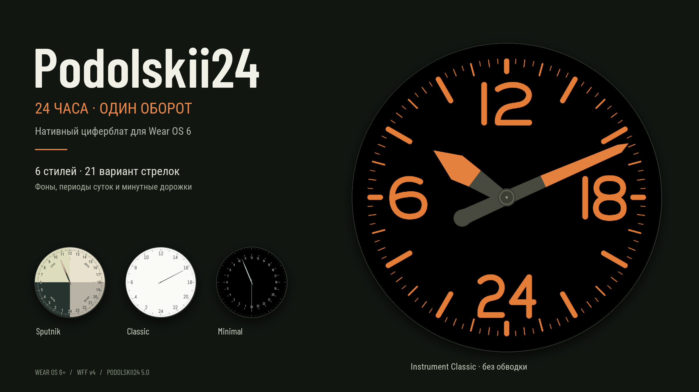
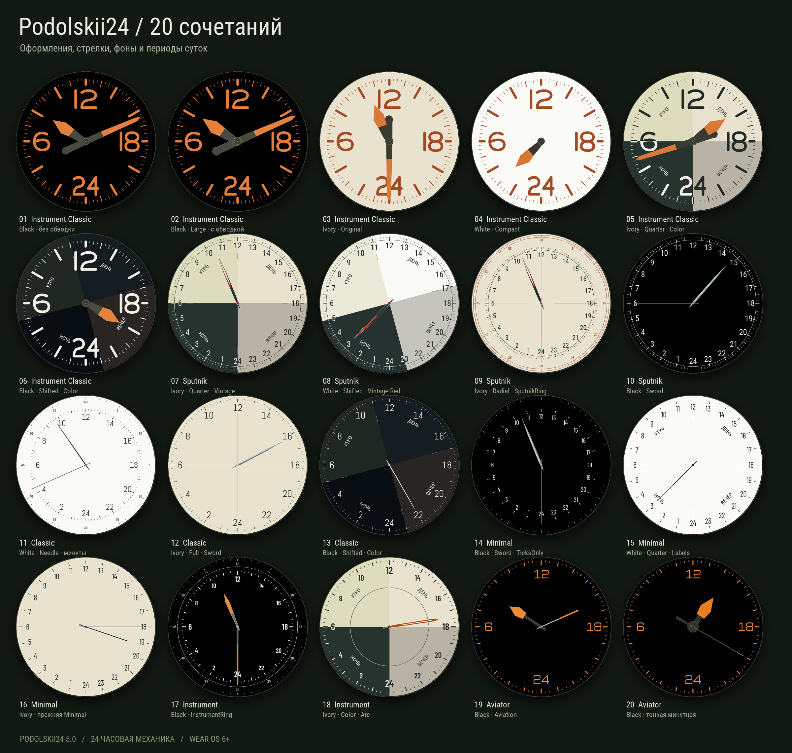

# Podolskii24

Текущая проверочная версия **5.3**: [оптимизация и проверки](docs/optimization/REPORT-5.3.md). [Как продолжить разработку на другом ПК](docs/DEVELOPMENT.md). Основой остаётся оригинальный проект TwentyFour. Стабильность и AOD после изменений ещё требуют проверки на часах.

Нативный 24-часовой циферблат для Wear OS 6+ (WFF v4). Один оборот за сутки: 12 сверху, 6 слева, 18 справа, 24 снизу.



## Скачать

[Проверочный APK 5.3](https://github.com/svyatoslavpodolskii/podolskii24/releases/tag/v5.3).
Требуется Wear OS 6 / API 36+. На Galaxy Watch 6 проверьте установленную версию ОС.

Установка на часы через ADB:

```sh
adb connect IP:PORT
adb install -r Podolskii24-5.3.apk
```

Выберите **Podolskii24** в списке циферблатов. Настройки: удержание циферблата → Настроить.
Идентификатор `dev.twentyfour.watchface` сохранён для обновления прежних сборок.

## Возможности

- 6 стилей: Classic, Minimal, Sputnik, Instrument, Aviator, Instrument Classic.
- Фоны White / Ivory / Black; 13 ручных вариантов стрелок и автоматический выбор.
- Секторы None / Lines / Labels / Color.
- Границы Quarter (00/06/12/18) и ShiftedBack1Hour (23/05/11/17).
- Разделители Micro / Radial / Full / Arc / Classic.
- Минутная дорожка None / TicksOnly / FiveMinuteLabels / SputnikRing / InstrumentRing.
- Независимый цвет минутной дорожки: исходный, белый/тёмный, оранжевый, зелёный, голубой.
- Отключаемая минутная стрелка, AOD, три слота дополнений.

## Версия 5.0

Instrument Classic получил собственные векторные цифры и 96 отметок. Прежние стрелки сохранены. Добавлены вариант без обводки и размеры Compact / Original / Large. Часовая Instrument Classic расположена поверх минутной, центральный узел — поверх обеих.

- [Шкала без стрелок](docs/previews/new_classic_scale.jpg)
- [Полный циферблат на трёх фонах](docs/previews/new_classic_full.jpg)
- [Размеры](docs/previews/classic_hand_sizes.jpg)
- [С обводкой и без](docs/previews/classic_outline_comparison.jpg)
- [Разные положения](docs/previews/classic_new_time_checks.jpg)
- [Проверки](docs/VALIDATION.md)



## Сборка

JDK 21, Android SDK 36, Build Tools 35.0.0, Python 3.10+:

```sh
python -m pip install -r tools/requirements-preview.txt
python tools/generate.py
python -m unittest discover -s tools -p 'test_*.py' -v
./gradlew :watchface:exportDebugApk :watchface:lintDebug --no-daemon
python tools/verify_apk.py dist/Podolskii24-debug.apk
```

WFF: `watchface/src/main/res/raw/watchface.xml`. Генераторы: `tools/`. Собственные SVG: `docs/hand-masters/`, `docs/scale-masters/`.
`python tools/generate.py` обновляет WFF, `python tools/forum_pack.py` создаёт изображения из ресурсов WFF.

Превью созданы локальным рендерером; проверка на реальных часах пока не проводилась.
Публичный APK подписан существующим локальным ключом. CI создаёт debug-сборку со своим ключом; она может потребовать удаления предыдущей версии. Ключи подписи не публикуются.
Лицензии сторонних шрифтов и валидатора сохранены рядом с ресурсами. Bell & Ross — визуальный референс; проект не связан с производителем.


